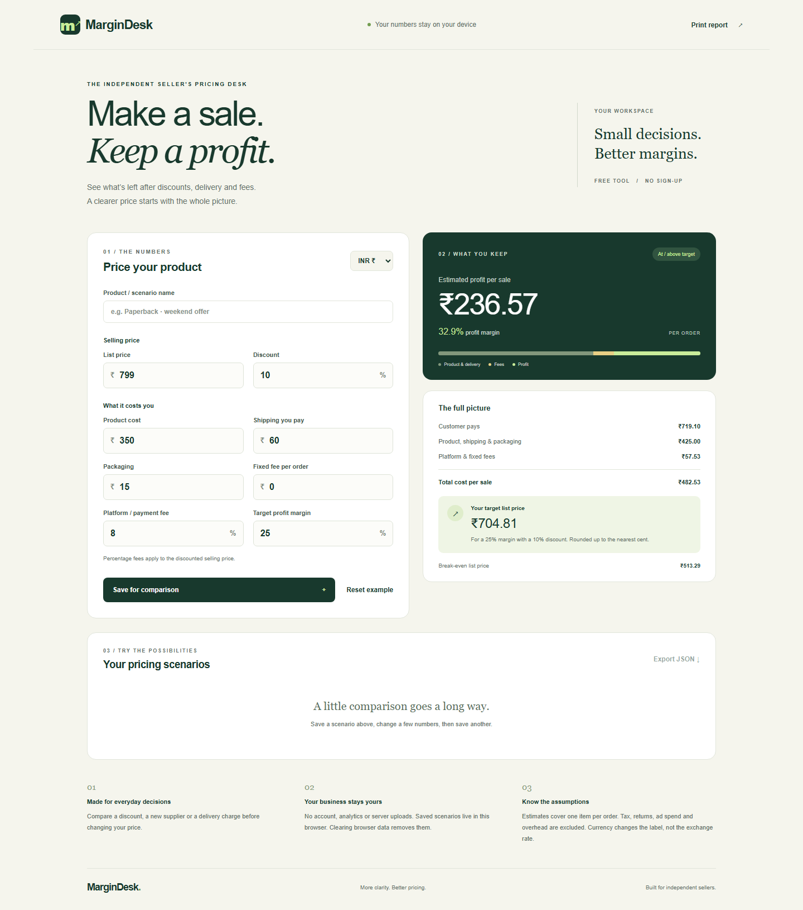

# MarginDesk

A responsive, browser-based pricing calculator for independent sellers. Calculate per-order profit after discounts, product cost, delivery, packaging and platform fees. Compare up to 12 saved scenarios, export them as JSON, and print a report.

**[Open the live app](https://harshgulatidev.github.io/margindesk/)**

[](https://github.com/harshgulatidev/margindesk/actions/workflows/test.yml)
[](https://github.com/harshgulatidev/margindesk/actions/workflows/deploy.yml)



## Features

- Live profit, margin, break-even list price and target-margin pricing
- INR, USD, GBP and EUR display (no exchange-rate conversion)
- Browser-local scenario storage with graceful fallback when storage is unavailable
- No accounts, analytics, API calls or third-party browser scripts
- Keyboard-accessible controls, mobile layouts and print styles
- Explicit handling of losses, free orders and unattainable targets

## Run locally

Use Node.js 22 or later:

```sh
npm ci
npm run build
npm start
```

Visit `http://localhost:3000`. The Express server serves only the app's static assets; `/healthz` provides a readiness check. No database, API key or required environment variable is needed. Hosting platforms may supply `PORT`; it defaults to `3000` locally.

For a static-only preview, run `python -m http.server 8080 --directory dist`, then visit `http://localhost:8080`.

Run the calculation and server tests:

```sh
npm test
```

## Deploy independently

GitHub Actions runs the build and tests, then publishes `dist/` to GitHub Pages. No company server, SSH key or external hosting account is required. Enable Pages with GitHub Actions as the source in repository settings.

For another static host, upload the five files in `dist/`. The relative asset paths also support hosting under a project subdirectory. The optional Express server can run on any Node.js 22+ host using the local commands above.

## Calculations

Revenue = list price × (1 − discount / 100).

Profit = revenue × (1 − percentage fee / 100) − product cost − shipping − packaging − fixed fee.

Margin = profit / revenue × 100. Margin is undefined when revenue is zero.

Target list price = (product cost + shipping + packaging + fixed fee) / ((1 − discount / 100) × (1 − (fee + target margin) / 100)). A non-positive denominator makes the target unavailable. Suggested and break-even prices round upward to the nearest currency cent; calculations retain full precision.

Assumptions: one item per order. Tax, returns, advertising and overhead are excluded. The shipping field is the amount the seller pays; customer-paid shipping is not modeled separately. The app provides arithmetic estimates, not accounting or tax advice.

## Privacy and security

Inputs stay in the browser. Saved scenarios use `localStorage`; clearing browser data deletes them. Exported files contain the scenario names and numbers you entered. No secret keys are required. Product names render as text, never HTML. A Content Security Policy blocks network connections from application JavaScript.

## Repository hygiene

Publish this project directory only. Existing deployment utilities, passwords, SSH private keys, WordPress configuration and customer databases must remain outside the repository. GitHub account SSH keys accept public keys only. Server credentials for automation belong in restricted repository/environment secrets if needed.

## Verification

The automated suite covers seven calculation cases and three Node.js server cases, including health checks and keeping repository/private paths out of the public site. Fourteen browser checks cover desktop/mobile rendering, saved scenarios, persistence, text-only product names, loss states, target pricing, validation, currency labels, export, removal and print output. Desktop and mobile screenshots were visually reviewed. See `browser-verification.json` and `deployment-verification.json` for results. The Actions badges above show the current test and deployment status.

## License

Open-source under the [MIT License](LICENSE). You may use, modify and self-host the app under that license.
